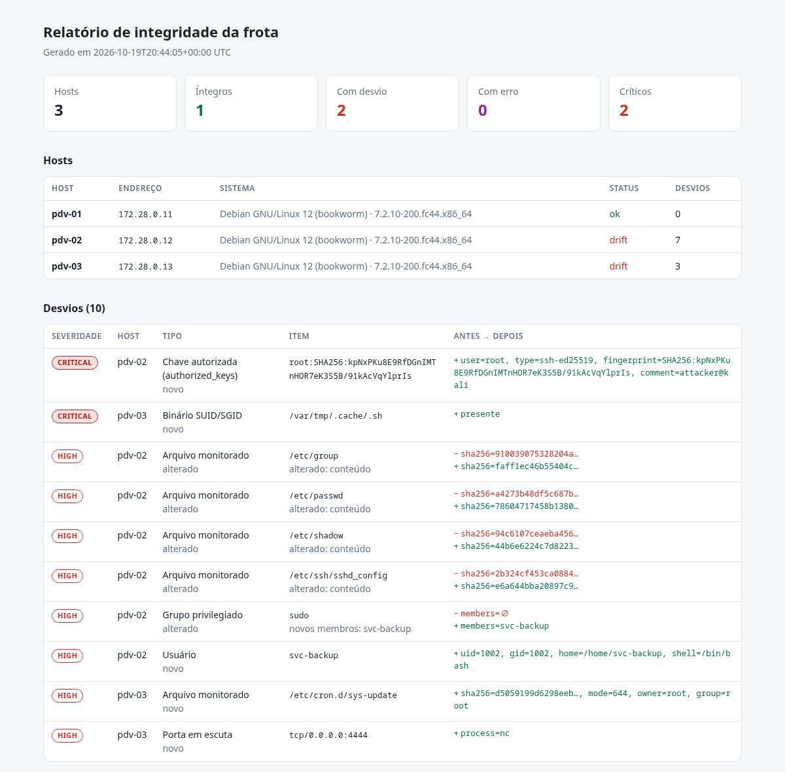

# fleetwatch

[](https://github.com/viniciustrembulak/fleetwatch/actions/workflows/ci.yml)


**Monitor de integridade e desvio de configuração para frotas de servidores Linux, sem agente.**

O fleetwatch conecta via SSH em dezenas de máquinas ao mesmo tempo, registra uma *baseline* do estado confiável de cada uma e, nas execuções seguintes, aponta tudo o que mudou: arquivos críticos alterados, usuários e chaves SSH novos, portas abertas, binários SUID e serviços que não estavam lá. Cada desvio recebe uma severidade, e os resultados saem no terminal, em JSON, em HTML ou num webhook.

Foi pensado para ambientes com muitas máquinas parecidas (PDVs de varejo, quiosques, filiais, servidores de borda), onde instalar um agente em cada host não é viável, mas onde é preciso saber quando uma máquina deixou de ser igual às outras.



## O que é verificado

| Coletor    | O que detecta | Técnica MITRE ATT&CK relacionada |
|------------|---------------|----------------------------------|
| `files`    | Hash SHA-256, permissão e dono de arquivos críticos (aceita glob) | T1543, T1053, T1556, T1574.006 |
| `users`    | Usuários novos, removidos ou alterados; alerta crítico para UID 0 | T1136 |
| `groups`   | Mudança de membros em grupos privilegiados (`sudo`, `wheel`, `docker`…) | T1098 |
| `ssh_keys` | Chaves novas em `authorized_keys` de qualquer usuário (por fingerprint) | T1098.004 |
| `ports`    | Portas TCP/UDP em escuta e o processo dono | T1571 |
| `services` | Serviços systemd em execução | T1543.002 |
| `suid`     | Binários SUID/SGID novos | T1548.001 |
| host key   | Troca da chave SSH do próprio host (máquina substituída ou MITM) | T1557 |

## Como funciona

```
                 inventory.yml + policy.yml
                            │
                     ┌──────▼──────┐   1 sessão SSH por host,
                     │  fleetwatch │── script POSIX via stdin ──▶ pdv-01, pdv-02, ... pdv-N
                     └──────┬──────┘   (nada é instalado no host)
                            │
          baseline ─────────┼───────── scan
     baselines/<host>.json  │   diff com a baseline → severidade
                            ▼
              console · JSON · HTML · webhook
```

- **Sem agente:** só precisa de SSH e de ferramentas presentes em qualquer distro (`sha256sum`, `getent`, `ss`, `find`).
- **Uma conexão por host:** toda a coleta roda num único script enviado pelo stdin, com hosts verificados em paralelo.
- **TOFU para chaves de host:** a fingerprint da chave SSH fica guardada na baseline; se ela mudar, o desvio é crítico. Também é possível usar um `known_hosts` próprio.
- **Política segura:** os padrões de arquivo são validados antes de entrarem no script remoto, para evitar injeção de comandos pela configuração.
- **Códigos de saída para automação:** `0` sem desvios, `1` com desvios e `2` em caso de erro, o que permite usar o fleetwatch em cron, CI ou Zabbix.

## Laboratório com containers

O diretório [`lab/`](lab) sobe 3 hosts Debian com SSH, simulando uma frota de PDVs, além do próprio fleetwatch em container. Para usar, você precisa apenas de Docker com Compose e de `make`.

```bash
make lab-up      # gera a chave SSH do lab e sobe pdv-01, pdv-02 e pdv-03
make baseline    # registra o estado confiável
make attack      # simula um comprometimento em pdv-02 e pdv-03
make scan        # mostra os desvios e salva relatórios em lab/reports/
make lab-down    # derruba tudo
```

O `make attack` executa técnicas reais de persistência:

| Host   | Ação simulada | Detectado como |
|--------|---------------|----------------|
| pdv-02 | Cria `svc-backup` no grupo `sudo` | usuário novo, grupo privilegiado alterado |
| pdv-02 | Adiciona chave SSH do atacante em `/root/.ssh/authorized_keys` | **CRITICAL** chave autorizada nova |
| pdv-02 | `PermitRootLogin yes` no `sshd_config` | arquivo monitorado alterado |
| pdv-03 | Cron em `/etc/cron.d/sys-update` baixando um script | arquivo novo em local de persistência |
| pdv-03 | Cópia SUID do bash em `/var/tmp/.cache/.sh` | **CRITICAL** binário SUID novo |
| pdv-03 | `nc -lk 4444` (bind shell) | porta nova em escuta |

O pdv-01 não é alterado e precisa continuar `ok`. O CI repete esse ciclo inteiro a cada push.

## Uso em ambiente real

```bash
pipx install git+https://github.com/viniciustrembulak/fleetwatch
```

**inventory.yml**

```yaml
defaults:
  user: auditor           # usuário dedicado, somente chave
  key_file: ~/.ssh/fleetwatch
  become: true            # executa a coleta com sudo -n
  timeout: 10
  # known_hosts: ~/.ssh/known_hosts_frota   # opcional: verificação estrita

hosts:
  - name: loja01-pdv
    address: 10.10.1.101-130    # range → loja01-pdv-01 ... loja01-pdv-30
  - name: servidor-loja01
    address: 10.10.1.10
  - address: 10.20.0.0/28       # CIDR também funciona
```

**policy.yml**: veja o exemplo completo em [`lab/policy.yml`](lab/policy.yml).

```yaml
files:
  - /etc/passwd
  - /etc/sudoers.d/*
  - /etc/ssh/sshd_config
  - /etc/cron.d/*
  - /etc/systemd/system/*.service
collectors: [files, users, groups, ssh_keys, ports, services, suid]
ignore:
  ports: ["68"]
  addresses: ["127.0.0.53"]
```

```bash
fleetwatch inventory                     # confere a expansão dos hosts
fleetwatch baseline                      # registra o estado confiável
fleetwatch scan --html reports/{ts}.html --json reports/{ts}.json
fleetwatch scan --webhook https://hooks.slack.com/... --notify-min high
fleetwatch baseline --host loja01-pdv-07 # aceita uma mudança legítima em um host
```

No sudoers dos hosts, basta liberar o comando usado pela coleta:

```
auditor ALL=(root) NOPASSWD: /bin/sh -s
```

> Essa regra dá ao usuário de auditoria poder de root via shell. Proteja a chave privada e, se possível, restrinja a origem com `from="IP-do-coletor"` no `authorized_keys`.

### Agendamento

```cron
*/30 * * * * cd /opt/fleetwatch && fleetwatch scan --webhook "$WEBHOOK" --json reports/{ts}.json
```

## Desenvolvimento

```bash
python -m venv .venv && . .venv/bin/activate
pip install -e '.[dev]'
make test lint
```

## Roadmap

- [ ] Exportar desvios em formato compatível com Wazuh/Elastic (ECS)
- [ ] Baseline por grupo de hosts (comparar um PDV com o "padrão ouro" da frota)
- [ ] Monitorar pacotes instalados (`dpkg`/`rpm`)
- [ ] Integração nativa com Telegram

## Licença

[MIT](LICENSE)
